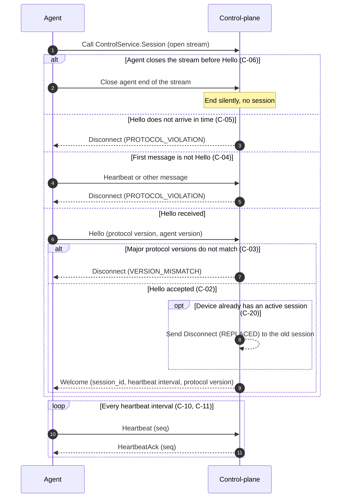
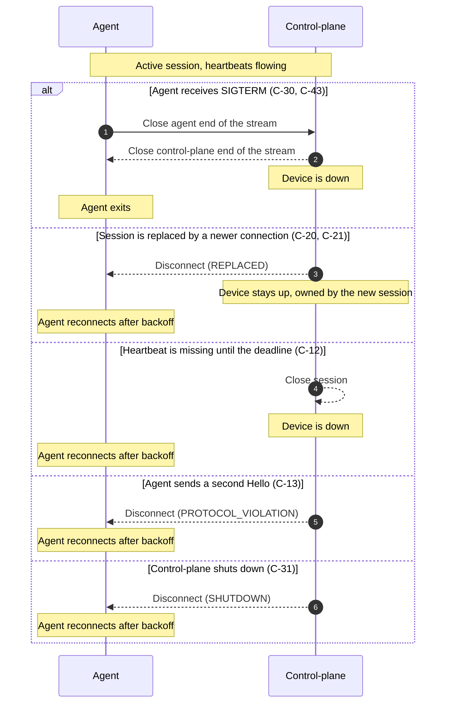
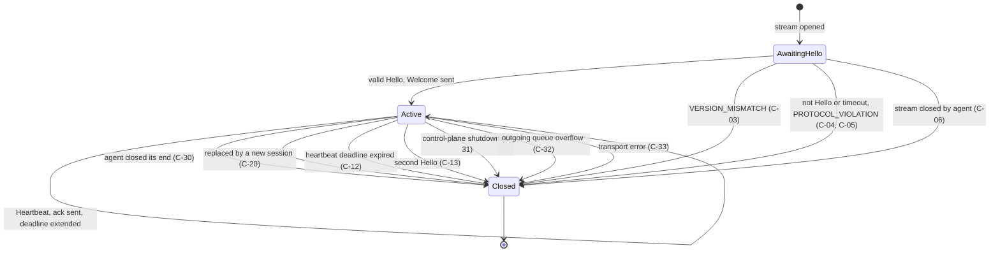
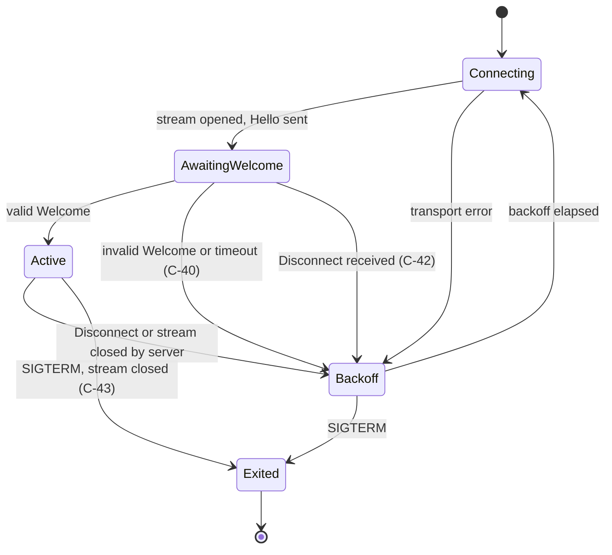

# 03. Protocol Contract between agent and control-plane

- **Status:** draft v0.2
- **Date:** 2026-10-15
- **Related documents:** [01 Containers](./01-containers.md),
  [02 Agent Identity](./02-agent-identity.md)

## Overview

The agent and control-plane communicate over a single long-lived
bidirectional gRPC stream: `ControlService.Session`. The agent always opens
the stream by calling the RPC. The first message inside the stream is `Hello`,
and control-plane answers with `Welcome`. After that, the agent sends
heartbeats and control-plane acknowledges them.

The device identity is not transferred in messages. Control-plane takes it
from the authenticated connection (see 02 Agent Identity).

This document is the source of truth for the protocol behaviour. Every rule
below has a stable ID, and every rule is covered by at least one test that
references this ID.

## Rules

Rules use **MUST** for mandatory behaviour. IDs are never reused. A rule
marked _(proposed)_ is not confirmed yet, see [Open Questions](#open-questions).

### Handshake

- **C-01.** The agent opens the stream by calling `ControlService.Session`.
  The first message from the agent MUST be `Hello`.
- **C-02.** If `Hello` is accepted, control-plane MUST reply with `Welcome`
  containing a non-empty `session_id`, a positive heartbeat interval and its
  protocol version.
- **C-03.** If the major protocol versions differ, control-plane MUST reply
  with `Disconnect(VERSION_MISMATCH)` and close the stream. No session is
  created.
- **C-04.** If the first message is not `Hello`, control-plane MUST reply with
  `Disconnect(PROTOCOL_VIOLATION)` and close the stream. No session is
  created.
- **C-05.** If `Hello` does not arrive within the hello timeout,
  control-plane MUST reply with `Disconnect(PROTOCOL_VIOLATION)` and close the
  stream. No session is created.
- **C-06.** If the agent closes the stream before sending `Hello`,
  control-plane MUST end the session silently. No session is created.

### Heartbeat

- **C-10.** For every `Heartbeat`, control-plane MUST reply with
  `HeartbeatAck` carrying the same `seq`.
- **C-11.** Every `Heartbeat` MUST extend the session deadline by
  `heartbeat interval × allowed misses`.
- **C-12.** If no `Heartbeat` arrives before the deadline, control-plane MUST
  close the session, and the device is considered down.
- **C-13.** A second `Hello` in an active session is a protocol violation.
  Control-plane MUST reply with `Disconnect(PROTOCOL_VIOLATION)` and close the
  session.
- **C-14.** _(proposed)_ Control-plane MUST ignore agent messages of unknown
  types and keep the session open.

### Replacement

- **C-20.** A new session of a device that already has an active session
  MUST replace the old one. The old session receives `Disconnect(REPLACED)`.
- **C-21.** Closing a replaced session MUST NOT mark the device down. Only
  the current session of a device can change its status.

### Closing

- **C-30.** When the agent closes its end of the stream, control-plane MUST
  close its end and mark the device down immediately.
- **C-31.** When control-plane shuts down, every active session MUST receive
  `Disconnect(SHUTDOWN)` before the stream is closed.
- **C-32.** _(proposed)_ If the outgoing queue of a session overflows,
  control-plane MUST close the stream with gRPC status `RESOURCE_EXHAUSTED`
  without sending `Disconnect`, and mark the device down.
- **C-33.** If the stream fails with a transport error, control-plane MUST
  release the session and mark the device down.

### Agent behaviour

- **C-40.** The agent MUST reject a `Welcome` with a missing, zero, negative
  or out-of-range heartbeat interval, or with an empty `session_id`.
- **C-41.** The agent MUST ignore server messages of unknown types.
- **C-42.** After `Disconnect(VERSION_MISMATCH)` the agent MUST retry with a
  long backoff. After any other disconnect it MUST retry with the regular
  backoff.
- **C-43.** On `SIGTERM` the agent MUST close its end of the stream, wait for
  control-plane to close its end (bounded by a timeout) and exit without
  reconnecting.

## Parameters

| Parameter                         | Default         | Owner          | Delivered to agent |
| --------------------------------- | --------------- | -------------- | ------------------ |
| Hello timeout                     | 5 s             | `ServerConfig` | no                 |
| Heartbeat interval                | 15 s (proposed) | `ServerConfig` | yes, in `Welcome`  |
| Allowed misses                    | 3               | `ServerConfig` | no                 |
| Outgoing queue size (per session) | 32              | `ServerConfig` | no                 |
| Welcome timeout                   | 10 s (proposed) | agent config   | -                  |
| Max accepted heartbeat interval   | 1 h             | agent config   | -                  |

All timings are configuration values, not constants, so tests can use short
values.

## Connection

## Disconnection

## Session states: control-plane

A session is registered only when it enters `Active`. Only the current session
of a device marks the device down on `Closed` (C-21).

## Session states: agent

## Traceability

Every test that verifies a rule references its ID in the doc comment, for
example `/// C-12: ...`. CI checks that every rule ID in this document is
referenced by at least one test, and that every ID referenced by a test exists
in this document. Rules marked _(proposed)_ are excluded from the check until
they are confirmed.

## Open Questions

1. **C-14.** Should control-plane ignore unknown agent messages (symmetric with
   C-41, allows rolling out agents before servers) or treat them as a protocol
   violation (stricter)?
2. **C-32.** Is closing without `Disconnect` on queue overflow acceptable, or
   should one slot be reserved for the final `Disconnect`?
3. **Heartbeat interval default.** 15 s is a placeholder.
4. **Agent-side liveness.** Should the agent treat a missing `HeartbeatAck` for
   N intervals as a dead connection and reconnect? This would become rule
   C-44.
5. **Welcome timeout default.** 10 s is a placeholder.
